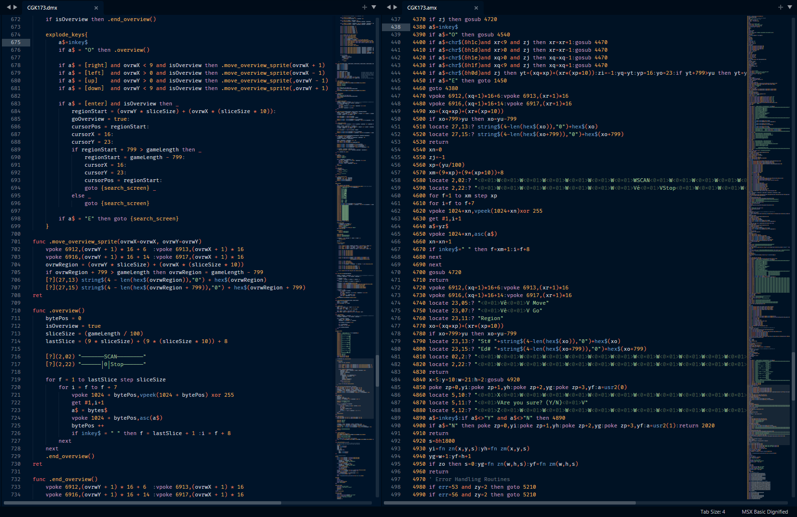

  
  
# Basic Dignified Suite  
**v2.2.1**  
    
> The **2.0+ versions** of the Basic Dignified Suite is slightly **incompatible** with the **previous versions** so old Dignified code must be **updated** accordingly. A list of incompatibilities is available [here](documentation/DIFFERENCES.md).  
    
**Basic Dignified** is a way for programming classic 8bit computer Basics on a modern, friendly paradigm. MSX, CoCo and ZX Spectrum Basics are supported and more can be added through modules.  
  
With **Basic Dignified** you can program for the included systems on a modern environment using Sublime Text or Visual Studio Code with syntax highlight, build systems, snippets and more.  
  
**Basic Dignified** improves and adds to the classic Basic, keeping the syntax as close as possible to the original, making the learning curve almost inexistent (the only requirement is the use of labels instead of line numbers), while adding a lot of quality of life improvements that can be used or not. The output is converted to the classic Basics and can run automatically on an emulator.  
  
Dignified Basic is written **without line numbers**, can be **indented**  and have **lines broken**, can use variables with **long names**, have macros **defined** and external files **included**, has a kind of **function** construct, can use **Unicode** special characters analogues to the original character set, as well as **rem toggles**, **true** and **false** statements, **compound arithmetic** operators and much more.  The conversion is customizable with controls for **line numbers**, **spaces**, **code cleanup** and more.  
  
The suite is designed to be very **modular**, implementing any **flavor** of Basic through modules that describe their **unique** characteristics. The **modules** are programmed **independently** and loaded as needed.  

**External** tools like **tokenizers** and **emulators** to run and debug the code can be **easily** added through **individual** modules inside each system ecosystem.  
  
The module and tools can add their own **commands** and **directives** to the overall control of Basic Dignified.

The suite can be used directly from the terminal, through command line arguments, but it is best experienced inside  **IDEs** and code editors like **Sublime Text**, **VSCode** and others.  

The suite comes with modules for **MSX Basic**, **Color Computer Basic** and **ZX Spectrum Basic**, and **YOU** can make the next module. **Commodore 64**, anyone?  

| System | Selection | Dignified | Classic text | Binary output |
| :- | :- | :- | :- | :- |
| **MSX** | `-id msx` (default) | `.DMX` | `.AMX` | `.BMX` |
| **CoCo** | `-id coco` | `.DCC` | `.ACC` | `.BCC` / `.CAS` |
| **ZX Spectrum 48K/128K** | `-id zxspectrum` | `.DZS` | `.AZS` | `.TAP` / `.TZX` / `.Z80` / `.SNA` |

On **Spectrum**, numeric scalars keep their native **long names**; strings,
arrays and FOR controls use single letters or explicit **DECLARE** aliases.
**Graphic blocks**, **UDGs** and **REMX** are described in the
[Basic Dignified manual](documentation/BASIC_DIGNIFIED.md#zx-spectrum-characters).
The [Spectrum reference](documentation/ZX_SPECTRUM.md) covers the supported
Sinclair commands and limits. The Spectrum module is independently versioned
**1.10.0 preview**; the original suite remains **2.2.1**.
Native **DEF FN/FN**, tape/stream commands, literal **`\{XX}`** bytes and
the [Spectrum DignifieR](documentation/DIGNIFIER.md#zx-spectrum-dignifier) are included.
An optional **`--sp_model 128`** flag enables the 128K `SPECTRUM`/`PLAY`
tokens (Z80/SNA snapshots and other 128K-specific features remain out of
scope; see the [Spectrum reference](documentation/ZX_SPECTRUM.md#128k-model)).
This 128K addition is **not yet published** in a tagged release.
The 1.10.0 VSIX supports both 48K and 128K through its
`spectrum-basic.model` setting. EightyOne automatic 128K loading has a
known freeze; use manual loading as documented in the Spectrum reference.
The [published preview](https://github.com/wilsonpilon/basic-dignified/releases/tag/spectrum-v1.9.0)
contains the source, editor packages and eight demos. See
[remaining work and priorities](OUTLINE.md#pendencias-priorizadas) for
manual validation, language coverage and final packaging.
  
The included modules contains the **Basic language description**, control for included **tokenizers**, the ability run the code on **emulators** and support for **Visual Studio Code** and **Sublime Text**  with **build system**, **syntax highlight** for the **Dignified** and **Classic** Basic versions as well as **themes**, **snippets**, **completions** and more.

>**Beyond** the Dignified code, Basic Dignified can open **classic** ASCII code to **tokenize**, **execute**, **monitor** and more.  

>On **openMSX** on the **Mac** or **Linux**, the code can be **monitored** during execution and errors are **reported** back to the correct line in the Dignified code.  

> On **MSX**, to help **kickstart** you on the **Dignified** thing, try **MSX Basic DignifieR** to **convert** a **classic** Basic to the **Dignified** format.  
  
---  
### [Installation](documentation/INSTALLATION.md)  
  
### [Using Basic Dignified and the Included Modules (MSX, CoCo and ZX Spectrum)](documentation/BASIC_DIGNIFIED.md)  
  
### [Additional Features of the Included Modules (Language, Tokenizers and Emulators)](documentation/MODULE_TOOLS.md)  

### [Visual Studio Code and Sublime Text Integration (Syntax Highlight, Snippets, Build System, etc)](documentation/IDE_TOOLS.md)

### [Creating Modules for Other Systems (SOON)](documentation/NEW_MODULES.md)  
  
### [Differences and Incompatibilities with v1.6](documentation/DIFFERENCES.md)  
  
### [Implementation Ideas, changes and Known Bugs](documentation/IMPLEMENTATIONS.md)  

#### Support Tools: [MSX Basic Tokenizer](documentation/BATOKEN.md), [MSX DignifieR](documentation/DIGNIFIER.md) and [CoCo to CAS](documentation/COCOTOCAS.md)  

---  
  
> **Basic Dignified** runs on **Python 3.8+**.  
> No external dependencies are needed.  
> **Spectrum snapshots** are optional and need a local **SkoolKit** installation.
> Text and **TAP/TZX** conversion still need no extra Python packages.
> See [installation](documentation/INSTALLATION.md#zx-spectrum-snapshots).
  
>**Basic Dignified** is constantly evolving so please report any misbehavior.  
  
> As always, **Basic Dignified** is offered as is, with no guaranties whatsoever. Use at your own discretion.  

Having said that, enjoy and send feedback.  
  
Thanks.  
  
---  
  
 
