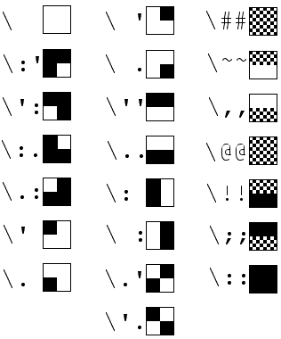
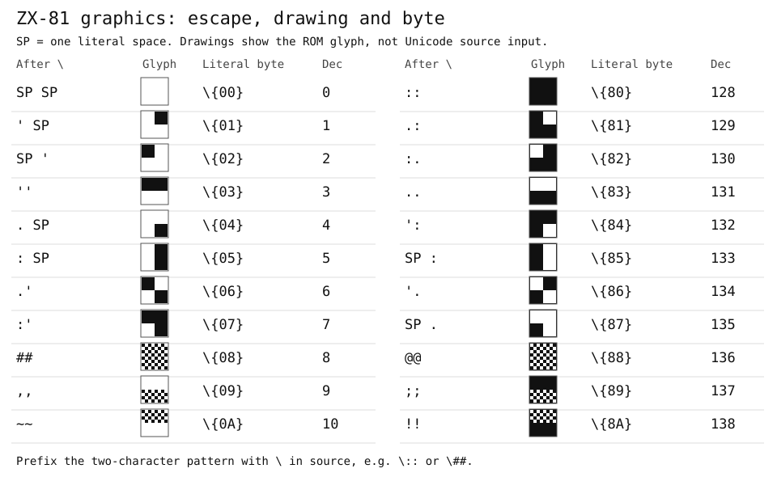

# Basic Dignified  
  
**Basic Dignified** reads a text file containing the **Dignified** code and write back **classic** Basic in **ASCII** and/or **binary** format (the binary output needs the included **tokenizer** modules).  
  
Throughout the suite, the file **extensions** are derived from **generic** names and depend on the current **system module** and the **file type**.  
The included modules use:  

|  MSX  | CoCo | Generic |Type|
|  :-:  | :-:  |   :-:   | :- |
|`.dmx` |`.dcc`| `.bad`  | **Dignified** code.|
|`.amx` |`.acc`| `.asc`  | **classic** Basic in **ASCII**.|
|`.bmx` |`.bcc`| `.bas`  | **classic** Basic in **binary**.|
|`.lmx` |      | `.lst`  | **list** format exported by the **tokenizer**.|

The additional ZX-81 module uses these extensions:

| ZX-81 | Type |
| :-: | :- |
| `.DZX` | Dignified source. |
| `.AZX` | Numbered classic BASIC in ASCII. |
| `.p` | Tokenized binary program. |
  
> The  system specific extensions will **avoid conflict** when more modules are available.  
> Generic and system specific extensions will be mentioned **interchangeably** across the documentation. i.e.: `.dmx` is the same as `.bad`.  
  
**[Features and usage](#Features-and-usage)**  
**[Configurable arguments](#Configurable-arguments)**  
**[The settings environments](#The-settings-environments)**  
  [The .ini file](#The-ini-file)  
  [The remtags](#The-remtags)  
  [The settings environments](#The-settings-environments)  
  
## Features and usage  
  
To run **Basic Dignified**, open a terminal window in its folder and type:  

`python badig.py <DIGNIFIED_CODE> [CLASSIC_CODE] [arguments]`  

> `python` may be omitted or be called `python3` depending on your installation.  

> Basic Dignified default system is the **MSX**. If using a **CoCo**, add `coco` to the `id` in the `.ini` file or add `-id coco` to the command line.

> For the additional ZX-81 module, use `-id zx81`.

### ZX-81 Sources

```console
python badig.py program.DZX -id zx81
python badig.py program.AZX -id zx81 -asc --tk_tokenize
```

Use the first form for Dignified source without line numbers; it generates numbered `.AZX` and tokenized `.p` by default. Use the second for an existing numbered classic listing. With `-id zx81`, a non-`.AZX` file whose first nonblank line starts with a line number is treated as a plain ZX-81 listing: its numeric `GOTO`, `GOSUB`, `RUN`, `LIST` and `LLIST` targets become labels, then the normal Dignified conversion generates a renumbered `.AZX` (honoring `-ls`, `-lp`, `-rh`, `-ca` and the other options) and renames long variable names from `Z` down. A target without its own line uses the next existing line, as on the ZX-81; computed targets such as `GOTO 10*X` stop the conversion, so use `-asc` to keep the original numbering. The source is not modified. `--tk_ascii_only` skips tokenization of a Dignified source, while `--em_run` launches EightyOne with the tokenized output.

ZX-81 sources support literal bytes as `\{XX}` in code, strings, and `REM`, where `XX` is exactly two hexadecimal digits. These are byte escapes, not Dignified labels. For example, `print "\{F5}"` stores a literal `F5` byte inside the string. A number immediately followed by `\{7E}` uses explicitly escaped hidden numeric bytes instead of a calculated value.

See [ZX-81 usage and byte escapes](MODULE_TOOLS.md#zx-81-usage-and-byte-escapes) for the full rules, Go81 listing examples, conversion helpers, and limitations.

For machine code, `remx <line>,<count>[,<byte>]` creates a `REM` line of `<count>` bytes, filled with the character `0` by default, at a fixed line number. See [machine code REM lines](MODULE_TOOLS.md#machine-code-rem-lines-remx). To turn a numbered program into Dignified code, use the [ZX81 Basic DignifieR](DIGNIFIER.md#zx81-basic-dignifier).

Two complete programs, with their Dignified source and generated classic listing, are shown in [ZX-81 examples](#zx-81-examples) at the end of this document.

### General Usage

>From now on, when showing code, usually the first excerpt is **Dignified** code, followed by the **program call** with the relevant **arguments** and the **classic** Basic output.  
>For the sake of clarity only arguments relevant to the current topic will be shown on the program call.  

> Differences between the included **MSX** and **CoCo** modules will be stated as needed.

> Additional ZX-81 differences are described in explicitly labeled sections.

> For an **explanation** on how to run Basic Dignified from **Visual Studio Code** or **Sublime Text** see [the page for the editor integration](https://github.com/farique1/basic-dignified/blob/main/documentation/IDE_TOOLS.md).  
  
Unlike traditional Basics, instructions, functions and variables in the Dignified version must be **separated** by spaces from alphanumeric characters as in modern languages. The **syntax highlight** will reflect this and there are settings to conform the spacing when the conversion is made.  
Dignified code should always **end** with a **blank line**.  
Code indentation is encouraged to help readability, **indentation** can be done with **TABS** or **SPACES**. The use os SPACES is highly **recommended**. When indenting with TABS use the argument `-tl <#>` to define the TAB **length** in spaces for better indication of **error reporting**.  
All blank lines are **removed** except the ones inside **regular** block comments `''`. All spaces are **stripped** from the **start** and **end** of a line.  
Some classic Basics are confused when **concatenating** certain **characters and words** so the Dignified code will try to accommodate for that by **separating** some of them even if told to strip all spaces. `x` and `or` are kept separated to avoid an `xor` by mistake and **hexadecimal** numbers followed by words beginning with `a` to `f` are kept separated.  
Duplicated separate instruction symbols (`:`) are removed.  
  
> As an **example** you can **convert**, **tokenize**, **run** and **monitor** the Dignified program `test.dmx` **stripping** all spaces, **capitalizing** all instructions and adding a line **report** about the **program flow** with:  
`python badig.py d:\msxapps\testdisk\test.dmx -ss -ca -lbr --tk_tokenize --em_run --em_monitor`  
Or you can use the **included** **Visual Studio Code extension** or the **Sublime Text package** and just **run** the code from there.  
> See below and [the module tools page](https://github.com/farique1/basic-dignified/blob/main/documentation/MODULE_TOOLS.md) for a detailed explanation of the arguments.

### Structure:  
  
 - **Labels**  
are used to direct the code flow since the **Dignified** code does not have line numbers.  
Labels are created using curly brackets `{like_this}` and can be used **alone** on a line to receive the code flow or on a **branching** (jump) instruction to direct the flow to the corresponding **line label**. They can only have **letters**, **numbers** and **underscore** and they cannot be only numbers or begin with a number. `{@}` is a special label that points to its **own line**.  
A special kind of label called **loop label** can be used to create a concise **closed loop**. It is opened with `label{` and closed with `}`. The **opening** label works like any regular label and the **closing** one will send the flow back to the opening label. Loop labels can be **nested**.  You can exit a loop label with the `exit` command, it will send the flow to the **next line** after the closing label.  
A **visualization** of the program flow can be generated by using the `-lbr` argument. At the end of each line a `<` or a `>` (depending on if the flow is coming or exiting this line) followed by its **label name** will appear as a comment. A **loop label exit** will be given a `*` and self-referencing line a `>@`  
A **summary** of the line number **associations** can be generated by using the `-lnr` argument.  It will be saved to a file but can be logged to the console using the `-prr` (print report) argument.  
	>Labels not following the **naming convention**, **duplicated** line labels, labels branching to **inexistent** line labels and loop labels **not closed** will generate an error and stop the conversion. Labels with illegal characters are **highlighted** when using the **syntax highlight**.  
	>**Lines** starting with **numbers** will generate an **error**, the highlight will show a warning.  
  
	```BASIC  
    {start}  
    print "press A to toggle"  
    if inkey$ <> "A" then goto {@}  
    loop{  
        a$ = inkey$  
        print "press B to exit"  
        if a$ = "A" then goto {start}  
        if a$ = "B" then exit  
    }  
    end  
	```  
	`badig.py labels.dmx`  
	```BASIC  
    10 PRINT "press A to toggle"  
    20 IF INKEY$<>"A" THEN GOTO 20  
    30 A$=INKEY$  
    40 PRINT "press B to exit"  
    50 IF A$="A" THEN GOTO 10  
    60 IF A$="B" THEN GOTO 80  
    70 GOTO 30  
    80 END  
	```  
  	Flow visualization with  `badig.py labels.dmx -lbr`  
	```BASIC  
    10 PRINT "press A to toggle" '<start  
    20 IF INKEY$<>"A" THEN GOTO 20 '>@  
    30 A$=INKEY$ '<loop  
    40 PRINT "press B to exit"  
    50 IF A$="A" THEN GOTO 10 '>start  
    60 IF A$="B" THEN GOTO 80 '*loop  
    70 GOTO 30 '>loop  
    80 END  
	```  
  	Report generated with  `badig.py labels.dmx -lnr`  
	```  
	8 lines generated.  
	(Classic - Dignified)  
	10 - 2  
	20 - 3  
	30 - 5  
	40 - 6  
	50 - 7  
	60 - 8  
	70 - 9  
	80 - 10  
	```  
  
- **Defines**  
create aliases on the code that are replaced when the conversion is made.  
They are defined with `define [name][content]` where the `content` will replace the `[name]`. Several can be defined on the same line, separated by commas: `define [name1][content1],[name2][content2],[name3][content3]`.  
A define `name` can only have **letters**, **numbers** and **underscore** and they cannot be only numbers or begin with a number.  
A **define variable** can be created using `[]` inside a `content` definition. It will be substituted by an `argument` that must be placed between **parenthesis** `()` after the `[name]` is used on the code. If there is content inside the brackets of the **define variable** it will be used as **default** if no argument is given.  
For instance, using `define [pk][poke 100,[10]]`, a subsequent `[pk](30)` will be replaced by `poke 100,30`; `[pk]` alone will be replaced by `poke 100,10`.  

  The included modules have a `[?](x,y)` **built in** define that becomes:

  **MSX:** `LOCATEx,y:PRINT`.  
      - If no `(x,y)` is given, a `0,0` will be used.  

  **CoCo:** `PRINT@c,`  
Depending on the content of `(x,y)`, `c` can be:  
      - No `(x,y)`: `0`  
      - Only `x`: `x`   
      - If there is no `y`, the following apply:  
      - - `y` and not `x`: `x` = `0`  
      - - `x` and `y` are only one number each: the result of *32 * y + x*  
      - - One of the terms is not a number (or is more than one): return the literal formula `32*(y)+(x)`  
      - - `:` or `line break` after the `PRINT`: do not add a `,` at the end  

	**ZX-81:** use the native `PRINT AT row,column;` syntax or the built-in `[?](row,column)` define, which expands to `PRINT AT row,column;`. Coordinates start at `0,0` in the upper-left corner (rows `0`–`21`, columns `0`–`31`). With no arguments the define uses `0,0`; with one argument it uses that row and column `0`.

	```BASIC
	message$ = "ZX-81"
	print at 10,5; message$
	```

	`badig.py print_at.dzx -id zx81`

	```BASIC
	10 REM Converted with Basic Dignified
	20 REM https://github.com/farique1/basic-dignified
	30 a$="ZX-81"
	40 print at 10,5;a$
	```

	A label can be used to repeat a positioned print:

	```BASIC
	{again}
	print at 10,5; "ZX-81"
	goto {again}
	```

	```BASIC
	30 print at 10,5;"ZX-81"
	40 goto 30
	```

	The native `FOR` loop can iterate over screen rows:

	```BASIC
	for row = 0 to 21
			print at row,0; row
	next row
	```

  > Defines can be used as variables for other defines.  
  > Duplicated **defines** will give an error and stop the conversion.  

  ```BASIC  
  define [ifa][if a$ = ],[enter][chr$(13)]  
  define [pause][if inkey$<>[" "] goto {@}]  
  
  [ifa]"1" then print "one"  
  [ifa]"2" then print "two"  
  [?](10,10)"ten by ten"  
  [pause]([enter])  
  ```  

  `badig.py defines.dmx`  

  ```BASIC  
  10 IF A$="1" THEN PRINT "one"  
  20 IF A$="2" THEN PRINT "two"  
  30 LOCATE 10,10:? "ten by ten"  
  40 IF INKEY$<>CHR$(13)GOTO 40  
  ```  
  
- **Long named variables**  
can be used on the Dignified code.  
They can only have **letters**, **numbers** and **underscore**, they cannot be only numbers, begin with a number or have less than 3 characters. Long named variable are **case insensitive**.
When converted they are replaced by an associated standard two letter variables. They are assigned on a **descending** order from `ZZ` to `AA` and **single letters** and **letter+number** are never used. Each long name is assigned to a short name independent of **type**, so if `variable1`  becomes `XX` so will `variable1$` become `XX$`.
An **explicit** assignment between a long and a short name can be **forced** using the `declare` instruction: `declare variable:va` will assign `VA` to `variable`. Several declares can be given on the same line, separated by commas: `declare variable1:v1,variable2:v2,variable3:v3`.
A `declare` can also be used to **reserve** short named variables: `declare zz,xv,cd` will **prevent** those letters from being assigned to long named variables. You cannot reserve **one letter** variables (buy you also don't need to).
As variables are assigned independent of type, explicit type character (`$%!#`) cannot be used on a `declare` line.  
**Reserved** Basic commands should not be declared as variables as they might be assigned and converted.  
**One** and **two** letters variables used directly will **not** be **converted**. Warnings and/or errors will be given in case of conflicts.
A `~` **before** the variable name will keep its **long** name. Some Basics accepts long names, **discarding** all characters after the **second** one. `~` cannot be used on a short named variable. A `declare` can be used to reserve a long named variable the same way a short one is reserved.
Hardcoded short named variables and the first two characters of reserved long variables are not used by long named substitutions to short names.
A **summary** of the long and short name **associations** can be generated by using the `-var` argument.  It will be saved to a file but can be logged to the console using the `-prr` (print report) argument.  
	>The conversion (and the **syntax highlight**) will catch illegal variables when declaring. Repeated declarations will cause an error. A warning will be given if **hardcoded** short named variables are **already** assigned and if a short name hard coded was already used by **substitution**. Warnings will also nag you if the first two letters between reserved long named and/or short named variables clashes.     

	> This type of variable handling is specific of the modules for the **MSX** and the **CoCo**.  
      Other classic modules can handle the variables in different ways.

	**ZX-81:** Dignified variable names longer than one letter are mapped to 26 one-letter names, allocated in descending order from `Z` to `A`, retaining `$` for strings. For example, `temperature$` becomes `z$`, then `counter` becomes `y`. Use `declare message:c` to choose a letter explicitly; declared and already-used letters are skipped by the automatic allocator. Only 26 long names can be mapped, and `~` cannot keep a long name on the ZX-81.


	```BASIC  
    declare food:fd, drink:dk  
    if food$ = "cake" and drink = 3 then end  
    result$ = "belly full"  
    ~sleep = 10  
    print result$  
	```  
	`badig.py vars.dmx`  
	```BASIC  
    10 IF FD$="cake" AND DK=3 THEN END  
    20 ZZ$="belly full"  
    30 SLEEP=10  
    40 PRINT ZZ$  
	```  
	Report generated with  `badig.py vars.dmx -var`  
	```  
	3 variables assigned  
	zz:result  
	fd:food  
	dk:drink  
	```  

- **Proto-functions**  
emulate the use of modern function definition and calls.  
They are **defined** with `func .functionName(arg1, arg2, etc)` and must end with `ret`. Their names can only have **letters**, **numbers** and **underscore** and they cannot be only numbers or begin with a number.  
The arguments can have **default values** as in `func .function(arg$="teste")` and `ret` can have **return variables** like `ret arg1, arg2, etc`.  
`ret` must be at the start of a line but you can use a `:` on the line above to make it part of that line (see **line breaking**).  
The functions are **called** with `.functionName(arg1, arg2, etc)` and can be **assigned** to variables like `var1, var2 = .functionName(args)`. They can be separated by `:` as usual and can also come after a `THEN` or `ELSE` as in: `if a=1 then .doStuff() else .dontDoStuff()`.  
Functions can be **called** with **less** arguments or returns than the ones on the function **definition**, the **excess** arguments will be **ignored**, but they **cannot** have **more** arguments.  
There can be only **one** `ret`, it will signal the **end** of the function definition. A regular `RETURN`, however, can be used inside the function to return from a **different** point. This `RETURN` cannot take variables.  
Obviously, there are no **local variables** on most of the **classical** Basics (which can limit the usefulness of the proto-functions) but this can be simulated by using **unique named** variables inside the functions. Proto-function can also be useful to apply different **results** to different **variables** at different **points** in the code.  
A function **call** is a `GOSUB` to a function **definition** with the variables assigned before and after it accordingly.  
If the arguments or return variable are the **same** between function calls and definitions, they will not be equated on the conversion to avoid **unnecessary repetition** like `A$=A$`.  
As with labels, proto-functions will have their flow visualized with the `-lbr` argument.  
Different from a normal function, `func` definitions will **not deviate** the **code flow** from itself so they must be placed at an **unreachable** point of the code.  
	>Most **classic** Basic are **very slow**, specially `GOTO` `GOSUB` instructions that scan the code, so keep that in mind when abusing proto-functions. They may be a little faster if placed at the start of the code.  
  
	```BASIC  
    letter$ = .upper("a")  
    print letter$  
    end  
    func .upper(up$)  
        ch = asc(up$) - 32  
    ret chr$(ch)  
	```  
	`badig.py func.dmx`  
	```BASIC  
    10 UP$="a":GOSUB 40:ZZ$=CHR$(CH)  
    20 PRINT ZZ$  
    30 END  
    40 CH=ASC(UP$)-32  
    50 RETURN  
	```  
  
- **Line separation**  
is possible with Basic Dignified using `:` or `_` at the **end** or **start** of a line. When converted, the lines are **joined** to form a single one.  
**Colons** `:` can be used at the **end** of a line to join the **next one** or at the **beginning** of a line to join it to the **previous one** and are retained in the converted code. Their function is the same as on some classic Basics, separating different instructions.  
**Underscores** `_` can only be used at the end of a line and they are **deleted** when the line is joined. They are useful to **break instructions** like `IF THEN ELSE` or anything that must form a single, unbroken, command on the converted code. They must be **separated** from the **last character** if it is a word character and they do not work at the end of **comments** or **open quotes**.  
**Quotes** can be **joined** simply by stringing them, even across different lines, like `PRINT "Hello " "word"`  
`endif`s can be used to mark the end of a multi-line `IF` statement but are for **cosmetical** or **organizational** purpose only, they will be **removed** without processing. An `IF` block is better defined by **indentation**, Python style.  
	> Numbers at the start of a line after a `_` or a `:` will be **preserved**.  
  
	```BASIC  
	if a$ = "" then _  
	    for f = 1 to 10:  
	        [?](1,1) f:  
	    next  
	    :[?](1,3) "All "  
	              "done."  
	    :end  
	endif  
	```  
	`badig.py lines.dmx`  
	```BASIC  
    10 IF A$="" THEN FOR F=1 TO 10:LOCATE 1,1:? F:NEXT:LOCATE 1,3:? "All done.":END  
	```  
  
- **Exclusive comments**  
are comments **stripped** during the conversion, they are defined by `##`.  
**Regular** `REM` or `'` comments are **kept**.  
**Block comments** can also be used, they are **opened** and **closed** with `''` or `###`, the text inside the first one will be **kept** while the text inside the later will be **removed**.  
  
	```BASIC  
    ## this will be removed  
    rem this will stay  
    ' this also will stay  
    ###  
    This will be removed  
    ###  
    ''  
    This will stay  
    ''  
	```  
	`badig.py rems.dmx`  
  
	```BASIC  
    10 REM this will stay  
    20 ' this also will stay  
    30 'This will stay  
	```  
  
- **Line toggles**  
tags parts of the code to be **removed** on **demand** when converted. They have the format `#name` where `name` can have **letters**, **numbers** and **underscore** and cannot be only numbers or begin with a number. They can be kept by simply using `keep #name1 #name2 #etc` on a line **before** them. `keep` can take **none**, **one** or **more** toggles on the same line, separated by spaces.  
There are two **special** toggles: `#all` **keeps** everything and  `#none` **removes** everything. If using both, `#none` has the precedence.  
Toggles are used at the **start** of a line (`#p print "Hello"`) or they can be **alone** to denote the **start** and **end** of a **block** to be removed, just like block comments. They can be **useful** to **debug** different code lines or sections without having to comment and uncomment them every time. Block toggles can be **nested** but cannot be **interleaved**.  
	>A warning will be given if line toggles are not closed.  
  
	```BASIC  
    keep #b  
    #a print "this will not be converted"  
    #b print "this will be converted"  
    print "this also will be converted"  
    #c  
    print "This will not be converted"  
    print "And neither will this"  
    #c  
	```  
  
	`badig.py toggles.dmx`  
  
	```BASIC  
    10 PRINT "this will be converted"  
    20 PRINT "this also will be converted"  
	```  
  
- **Classic Basic ASCII characters**  
are not supported by the default encoding of the `.bad` and `.asc` programs (`Western (Windows 1252)`). Their **representation** can be seen and used by opening an **ASCII** file **exported** from the computer/emulator and **copying/pasting** their symbols, but this is far from practical, a bit ugly and prone to problem.  
By using `UTF-8` encoding on the `.bad` file, **unicode** characters similar to the classic ones can be used on the Dignified code and be **translated** to their **analogue** counterparts when converting. This allows for a much cleaner and accurate presentation.

**ZX-81 note:** the Unicode mapping described here applies to MSX and CoCo; ZX-81 uses the ASCII and byte-escape forms described separately below.
The supported **unicode** characters for the **MSX ASCII** set are:  
  
	```  
      ÇüéâäàåçêëèïîìÄÅÉæÆôöòûùÿÖÜ¢£¥₧ƒáíóúñѪº¿⌐¬½¼¡«»ÃãĨĩÕõŨũIJij¾∽◇‰¶§▂▚▆▔◾▇▎▞▊▕▉▨▧▼▲▶◀⧗⧓▘▗▝▖▒Δǂω█▄▌▐▀αβΓπΣσμτΦθΩδ∞φ∈∩≡±≥≤⌠⌡÷≈°∙‐√ⁿ²❚■☺☻♥♦♣♠·◘○◙♂♀♪♬☼┿┴┬┤├┼│─┌┐└┘╳╱╲╂  
    ```  

    Special characters on the **CoCo** are a mess but the first set of graphic blocks is available using:  

    ```
	█ ▛ ▜ ▀ ▙ ▌ ▚ ▘ ▟ ▞ ▐ ▝ ▄ ▖ ▗
	```

	**ZX-81 character set**
	The `.AZX` file uses readable ASCII spellings; tokenization converts them to ZX-81 character and token codes in `.p`. The ZX-81 module currently has no Unicode translation table for `-tr`. Basic letters and digits map as follows:

	| ASCII input | ZX-81 character code |
	| :-: | :-: |
	| `A`–`Z` | 38–63 |
	| `0`–`9` | 28–37 |
	| Space | 0 |

	Common punctuation has these character codes:

	| ASCII input | Code | ASCII input | Code |
	| :-: | :-: | :-: | :-: |
	| `"` | 11 | `#` (ZX-81 pound sign) | 12 |
	| `$` | 13 | `:` | 14 |
	| `?` | 15 | `(` | 16 |
	| `)` | 17 | `>` | 18 |
	| `<` | 19 | `=` | 20 |
	| `+` | 21 | `-` | 22 |
	| `*` | 23 | `/` | 24 |
	| `;` | 25 | `,` | 26 |
	| `.` | 27 |  |  |

	Prefix a character with `%` to display it in inverse video. The backslash `\` introduces an escaped quote or a two-character block-graphics pattern. `SP` in the table means one literal space in the source, not the letters `SP`.

	For drawings beside the source patterns and byte values, see the [side-by-side ZX-81 graphic reference](#zx-81-graphics-escape-and-drawing). The existing table and original graphic chart are retained below.

	| Two characters after `\` | ZX-81 code | Two characters after `\` | ZX-81 code |
	| :-: | :-: | :-: | :-: |
	| `SP SP` | 0 | `::` | 128 |
	| `' SP` | 1 | `.:` | 129 |
	| `SP '` | 2 | `:.` | 130 |
	| `''` | 3 | `..` | 131 |
	| `. SP` | 4 | `':` | 132 |
	| `: SP` | 5 | `SP :` | 133 |
	| `.'` | 6 | `'.` | 134 |
	| `:'` | 7 | `SP .` | 135 |
	| `##` | 8 | `@@` | 136 |
	| `,,` | 9 | `;;` | 137 |
	| `~~` | 10 | `!!` | 138 |

	The patterns below show how each two-character escape draws a 2x2 ZX-81 graphic. The escape labels correspond to the code table above.

	

	Double a quote inside a string to print the ZX-81 quote character (token code `192`):

	```BASIC
	print "TESTE ""123"" OK"
	```

	Both doubled quotes and backslash-double-quote are accepted inside `.DZX` and numbered `.AZX` strings. Doubled quotes are the recommended form for ZX-81 listings. `%`, apostrophe, and `@` are used by the graphics/inverse escape syntax and are not ordinary literal characters in this tokenizer.

	The `-tr` Unicode translation table is currently not implemented for ZX-81.


    They were chosen for their **similarities** with the classic ones but the **actual shape** will depend on the **font used**.
    
    ```BASIC  
    print "┌──────┐"  
    print "│SAVING│"  
    print "└──────┘"  
    ```  
  
    `badig.py transl.dmx -tr`  
  
    ```BASIC  
    10 PRINT "XWWWWWWY"  
    20 PRINT "VSAVINGV"  
    30 PRINT "ZWWWWWW["   
	```  
    > The included modules have a **TrueType font** representing the fonts of the classic systems mapping those characters.  
  
  >When saving a Basic program as **ASCII** from **openMSX** (`save"file",a`) the text encode used is the `Western (Windows 1252)`. This is the format **Basic Dignified** uses to encode the `.asc` conversion and is the default encode for the `.bad` format as well. If **unicode translation** and special characters are used, the `.bad` format should be in the `UTF-8` format. The conversion will still generate a `Western (Windows 1252)` `.asc` file with the correct special characters translated to the **MSX ASCII** format.  
  
- **Include**  
is a command to **insert** an **external** Dignified file anywhere in the code.  
`include "code.bad"` will insert the **contents** of `code.bad` exactly where the `include` was and can even have its **lines joined** with the main code by using `:` or `_` before or after the `include` command.  
Included files have **separated** namespaces. **Rem toggles**, **functions**, **labels** and **defines** can have the same definition across the files **without conflict**.  
The same **Long named** variables are also assigned **different short names** across includes however they cannot have the same **declaration** across included files. **Reserved** long variables are also include independent (as are short named ones). As the classic Basics do not have namespaces, there is the possibility of conflicts between hardcoded variables, so **warnings** will be given if they clash.  
  
	`include.dmx`  
  
	```BASIC  
    print "This is the main file."  
    '  
    include "help.dmx"  
    '  
    print "This is the main file again."  
	```  
  
	`help.dmx`  
  
	```BASIC  
    print "this is a helper code."  
    print "Saved on another file."  
	```  
  
	`badig.py include.dmx`  
  
	```BASIC  
    10 PRINT "This is the main file."  
    20 '  
    30 PRINT "this is a helper code."  
    40 PRINT "Saved on another file."  
    50 '  
    60 PRINT "This is the main file again."  
	```  
  
- **True** and **false**  
statements can be used with **numeric** variables, they will be converted to `-1` and `0` respectively and their variables can be treated as true **booleans** on `IF`s and with `NOT` operators.  
  
	```BASIC  
    var_bool = true  
    condition = false  
    if condition then var_bool = not var_bool  
	```  
  
	`badig.py bool.dmx`  
  
	```BASIC  
    10 ZZ=-1  
    20 ZY=0  
    30 IF ZY THEN ZZ=NOT ZZ  
	```  
  
- **Shorthand** and **compound**  
arithmetic operators (`++`, `--`, `+=`, `-=`, `*=`, `/=`, `^=`) can be used and will be converted to **normal** classic Basic **operations**.  
  
	```BASIC  
    var1++ :var2--  
    var3 += 20 :var4 -= 10  
	```  
  
	`badig.py operat.dmx`  
  
	```BASIC  
    10 ZZ=ZZ+1:ZY=ZY-1  
    20 ZX=ZX+20:ZW=ZW-10  
	```  
  
  
## Configurable arguments  
  
The behavior of Basic Dignified is controlled through **command line arguments** or **remtags** (directives on the code) but several **levels** of **permanence** of the settings can be achieved.   

Configurations can be entered on:  
`code:` The **code itself** (in `\support\badig_settings.py`).  
`.ini:` The **.ini file** (in `\support\badig.ini`).  
`cmdl:` Through arguments on the **command line**.  
`rmtg:` Using **remtags**.  
  
Each method has a **priority** higher than the one before.  
  
> See [below](#The-settings-environments) for a **detailed description** of each of them and an **explanation** of what are **remtags**.  
  
> When not specified in the description below, **remtags** (`rmtg:`) are entered in `##BB:arguments=` exactly as in the **command line** (`cmdl:`).  
  
  
- *Source file*  
The Dignified or classic Basic file to be read.  
`Default:` `""`  
`code:` `self.file_load = ['SOURCE_FILE']`  
`.ini:` `source_file = [SOURCE_FILE]`  
`cmdl:` `<SOURCE_FILE>`  
`rmtg:` **none**  
  
- *Destination file*  
The classic Basic file to be saved.  
`Default:` **none**  
`code:` `self.file_save = ['DESTINATION_FILE']`  
`.ini:` `destin_file = [DESTINATION_FILE]`  
`cmdl:` `[DESTINATION_FILE]`  
`rmtg:` `##BB:export_file=[DESTINATION_FILE]`  
If no destination is given, the *source* name will be used with the appropriate extension.  
If only a file name is given, the file will be saved on the *source* folder.  
if only a path name is given, the file will be saved on that path with the *source* name.  
If no extension is given, the default extension will be used.  
Relative paths with the format `../../teste.asc` can be used.  
When loading a classic file, nothing will be saved.  
  
- *System ID*  
The classic system to work with.  
`Default:` `msx`  
`code:` `self.system_id = ['SYSTEM_ID']`  
`.ini:` `system_id = [SYSTEM_ID]`  
`cmdl:` `-id <SYSTEM_ID>`  
  
- *TAB Length*  
The number of spaces corresponding to a TAB on the code editor.  
This is necessary for the correct positioning of error reports when indenting with TABs.  
`Default:` `4`  
`code:` `self.tab_lenght = [#]`  
`.ini:` `tab_lenght = [#]`  
`cmdl:` `-tl <#>`  
  
- *Starting line number*  
The number of the first line on the converted classic code.  
`Default:` `10`  
`code:` `self.line_start = [#]`  
`.ini:` `line_start = [#]`  
`cmdl:` `-ls <#>`  
  
- *Line step value*  
The line number increment on the converted classic code.  
`Default:` `10`  
`code:` `self.line_step = [#]`  
`.ini:` `line_step = [#]`  
`cmdl:` `-lp <#>`  
  
- *Add a header about Basic Dignified*  
Add comment lines with information about **Basic Dignified** at the top of the converted code.  
	```  
	'Converted with Basic Dignified  
	'https://github.com/farique1/basic-dignified  
	```  
	`Default:` `True`  
	`code:` `self.rem_header = [True|False]`  
	`.ini:` `rem_header = [True|False]`  
	`cmdl:` `-rh`  

	**SPREAD THE WORD!**  
  
- *Strip spaces*  
The conversion will retain spaces around the instructions and variables but some classic Basics don't need them and all non essential spaces from the code can be removed.  
	`Default:` `False`  
	`code:` `self.strip_spaces = [True|False]`  
	`.ini:` `strip_spaces = [True|False]`  
	`cmdl:` `-ss`  
  
- *Capitalize all*  
Dignified code is more legible with lower case characters, but some classic Basics need their instructions in upper case.  
All non-literal text can be capitalized for compatibility.  
	`Default:` `False`  
	`code:` `self.capitalise_all= [True|False]`  
	`.ini:` `capitalize_all = [True|False]`  
	`cmdl:` `-ca`  
  
- *Translate special ASCII characters*  
Translate a special set of modern unicode characters to their classic ASCII counterparts.  
	`Default:` `False`  
	`code:` `self.translate = [True|False]`  
	`.ini:` `translate = [True|False]`  
	`cmdl:` `-tr`  
  
- *Convert `PRINT` or `?`* **(this is a feature of the MSX and CoCo modules)**  
Some classic Basics can use the shorthand `?` in place of `PRINT`.  
They can be converted from one to the other. `p` convert all prints to `print` and `?` will convert them to `?`.  
	`Default:` **none**  
	`code:` `self.convert_print = ['p'|'?']` **(on the language module)**  
	`.ini:` `convert_print = [p|?]` **(on the language module)**  
	`cmdl:` `-cp <p|?>`  
  
- *Strip adjacent `THEN`/`ELSE` or `GOTO`s* **(this is a feature of the MSX and CoCo modules)**  
Some Basics don't need both `THEN` or `ELSE` and `GOTO` if they are adjacent. The converted code can be told to strip `THEN`/`ELSE` or `GOTO` if it's the case. `t` strips all possible `THEN`/`ELSE` and `g` strips all possible `GOTO`s.  
	`Default:` **none**  
	`code:` `self.strip_then_goto = ['t'|'g']` **(on the language module)**  
	`.ini:` `strip_then_goto = [t|g]` **(on the language module)**  
	`cmdl:` `-tg <t|g>`  
  
- *Load classic code*  
Classic Basic code can be loaded instead of the Dignified one for tokenization, debugging, execution and more.  
Use this argument to tell Basic Dignified to interpret the loaded file as classic basic.  
	`Default:`  `False`  
	`code:` **none**  
	`.ini:` **none**  
	`cmdl:` `-asc`  

- *Verbose level*  
Set the level of feedback given by the program.  
 `0` = silent, `1` = +erros, `2` = +warnings, `3` = +headers, `4` = +info, `5` = +details.  
 A **negative** value forces this verbose level **across** all the **modules** and **tools**.   
	`Default:` `3`  
	`code:` `self.verbose_level = [#]`  
	`.ini:` `verbose_level = [#]`  
	`cmdl:` `-vb <#>`  

- *Print report*  
A series of reports can be generated detailing the conversion process.  
Normally these reports are saved as text files, but they can be logged to the console instead.  
	`Default:`  `False`  
	`code:` `self.print_report = [True|False]`  
	`.ini:` `print_report = [True|False]`  
	`cmdl:` `-prr`  
  
- *Label report*  
The Dignified label names can be added to the end of their lines on comments in the classic code to help debug the program flow.  
For instance: `50 IF a$="A" THEN GOTO 10 '>start` means the line `10` is the `{start}` label.  
Labels that receive the flow are preceded by an `<` and outgoing labels (on branching instructions) are preceded by an `>`, a loop label exit has an `*` and a `{@}` label is denoted by `>@`. Function definitions and calls also receive the same treatment.  
	`Default:`  `False`  
	`code:` `self.label_report = [True|False]`  
	`.ini:` `label_report = [True|False]`  
	`cmdl:` `-lbr`  
  
- *Line report*  
Also helping debug the program flow is a report of the line correspondence betwen the Dignified and classic codes.  
In te report, `20 - 11` means the line `20` in the classic Basic is the line 11 on the code editor in the Dignified version.  
	`Default:`  `False`  
	`code:` `self.line_report = [True|False]`  
	`.ini:` `line_report = [True|False]`  
	`cmdl:` `-lnr`  
  
- *Variables report*  
Another debug tool is the variable report. A report that shows the relationship between long named variables and its short named correspondence.  
In the report a `zz:char` means the Dignified long named `char` will be converted to the classic short name `zz`.  
The report is in the inverse `declare` and alphabetical order to help debug the converted code.  
	`Default:`  `False`  
	`code:` `self.var_report = [True|False]`  
	`.ini:` `var_report = [True|False]`  
	`cmdl:` `-var`  
  
- *Lexer report*  
There is also a report of the tokens generated by the lexing. The tokens are depicted in the format: `11 | 10 | C_INSTRC | width` where the `width` instruction has the `C_INSTRC` token and is on the line `11`, column `10`.  
	`Default:`  `False`  
	`code:` `self.lexer_report = [True|False]`  
	`.ini:` `lexer_report = [True|False]`  
	`cmdl:` `-lex`  
  
- *Parser report*  
And a report of the parsed tokens similar to the lexer one.  
	`Default:`  `False`  
	`code:` `self.parser_report = [True|False]`  
	`.ini:` `parser_report = [True|False]`  
	`cmdl:` `-par`  
  
- *Write the `.ini` file*  
Rewites the `.ini` file with the current settings.  
	`Default:` `False`  
	`code:` **none**  
	`.ini:` **none**  
	`cmdl:` `-ini`  
  
- *Use the `.ini` file*  
Tells if the `.ini` file settings should be used or ignored, allowing it to be easily disabled without being moved or deleted.  
	`Default:` `False`  
	`code:` **none**  
	`.ini:` `use_ini_file = [True|False]`  
	`cmdl:` **none**  
  
- *Help*  
All the commands available via the command line, including the ones exposed by the classic modules, can be obtainedwith:  
	`Default:` `False`  
	`code:` **none**  
	`.ini:` **none**  
	`cmdl:` `-h`  

- *Remtag help*  
All the remtags available, including the ones exposed by the classic modules, can be obtained with:  
	`Default:` `False`  
	`code:` **none**  
	`.ini:` **none**  
	`cmdl:` `-rtg`  
	`rmtg:` `##BB:help=[True|False]`  

### ZX-81 Graphics: Escape and Drawing

The visual table below places each source pattern beside its actual block or checkerboard drawing, decimal code and literal `\{XX}` spelling. It is drawn independently from the tokenizer's code table, following the character-chart presentation used by [ZXText2P](https://github.com/tomwhite/zxtext2p). White cells are blank; black areas are set pixels. The right-hand column shows inverse characters. These drawings are a visual reference, not Unicode characters accepted as source input.



Use the backslash followed by the two characters shown, for example `\::` for a solid block or `\##` for the checkerboard. Patterns containing `SP` require an actual space. Alternatively, `\{80}` and `\{08}` emit those same bytes literally. Unlike graphic escapes, literal byte escapes also work in `REM`.

```basic
print "\:: \## \{80} \{08}"
```

For inverse letters and punctuation, prefix the readable character with `%`, such as `%A` or `%$`. The pound-sign glyph **£** is written as `#` (or `\{0C}`), inverse `A` as `%A` (or `\{A6}`), and an embedded quote as `""` or `\"` (code `C0`). A literal `\{0B}` stores the quote-delimiter byte without changing the tokenizer's string state; it is not the displayed quote glyph. See [literal bytes and explicit numeric values](MODULE_TOOLS.md#literal-hexadecimal-bytes) for the complete escape rules, or [open the graphic table at full size](../zx81/zx81-graphics-reference.svg).

### ZX-81 module options

The ZX-81 module uses `.DZX` for Dignified source, `.AZX` for numbered ASCII BASIC, and `.p` for the tokenized program. Tokenization is enabled by default, so a normal conversion writes both `.AZX` and `.p`.

| Purpose | Command line | Remtag | Default |
| :- | :- | :- | :- |
| Generate the tokenized program | `--tk_tokenize` | `##BB:tk_tokenize=True` | On |
| Keep only numbered ASCII | `--tk_ascii_only` | `##BB:arguments=--tk_ascii_only` | Off |
| Delete `.AZX` after tokenizing | `--tk_del_ascii` | `##BB:tk_del_ascii=True` | Off |
| Launch EightyOne with `.p` | `--em_run` | `##BB:em_run=True` | Off |

`--tk_ascii_only` skips tokenization. `--tk_del_ascii` deletes the intermediate `.AZX` after tokenization. To process an existing numbered `.AZX` file, pass `-asc`; the ZX-81 tools then tokenize it by default.

Tokenizer settings are stored in `zx81/tokenizer_interface.ini`:

```ini
[CONFIGS]
tokenize = true
del_ascii = false
```

Emulator settings are stored in `zx81/emulator_interface.ini`:

```ini
[CONFIGS]
run = false

[WINDOWS]
emulator_path = C:\zeddy\EightyOne.exe
```

The emulator interface passes the generated `.p` path as the program argument. `--em_run` requires tokenization; it cannot launch `.AZX` directly. The general line-number options also apply: `-ls` sets the first generated line and `-lp` sets the increment (both default to 10).


### The settings environments  
Basic Dignified **permanent** or **temporary** settings and **behaviours** can be defined in several places, each with its own **priority**.  
  
>For an explanation of the **individual** settings see the section above.  
  
- **The code itself**  
The **lowest** level is in the `\support\badig_settings.py` file.  
Here the most **basic** behaviour is defined, the true defaults that can be modified by all subsequent methods. This is the **set and forget**, you should not be messing here.  
The code section is:  
  
	```  
	# System
	self.system_id =

	# User variables
	self.file_load =
	self.file_save =

	self.line_start =
	self.line_step =
	self.rem_header =
	self.strip_spaces =
	self.capitalise_all =
	self.translate =

	self.print_report =
	self.label_report =
	self.line_report =
	self.var_report =
	self.lexer_report =
	self.parser_report =

	self.tab_lenght =
	self.verbose_level =
	```  

	> Some configuration options like **Convert Print** and **Strip THEN/GOTO** are found on their respective modules.

- #### **The .ini file**  
  
  The next level in the hierarchy is the `\support\badig.ini` file.  
This is where you can enter **semi-permanent** settings, unique behaviour for the current project, maybe. This is the **friendly** place where to set the new defaults. The settings entered here will override the settings on the code.  
    
	```
	[CONFIGS]
	use_ini_file =

	source_file = 
	destin_file = 

	system_id = 

	line_start = 
	line_step = 
	rem_header = 
	strip_spaces =  
	capitalize_all = 
	translate = 

	print_report = 
	label_report = 
	var_report = 
	line_report = 
	lexer_report = 
	parser_report = 

	tab_lenght = 
	verbose_level = 
	```  
	> Some configuration options like **Convert Print** and **Strip THEN/GOTO** are found on their respective modules.

	> If `badig.ini` is not found, a new one will be regenerated and the execution will stop.  
  
- #### **The command line arguments**  
  
  Additional settings for each **individual** conversion can be passed through arguments on the command line. These arguments will override the previous methods and are useful to **test** different configurations.  

	```  
	usage: badig.py [input] [output]
					[-h] [-cp ?|p] [-tg t|g] [-id [ID]] [-tl #] [-ls #] [-lp #] [-rh] [-ss] [-ca] [-tr]
					[-vb #] [-prr] [-lbr] [-lnr] [-var] [-lex] [-par] [-asc] [-ini] [-rtg]
	```

- #### **The remtags**  
  
  Remtags are special **exclusive rem** lines that are used on the Dignified code itself to **alter** the behaviour of the conversion and execution of the code.  
Their main use is to allow for **quick** settings changes if you are using a **build system** but they can also be used on a command line setting and will override them and all the previous settings.  
They are commonly used at the start of the Dignified code:  
  
	```ini  
	##BB:export_file=
	##BB:arguments=
	##BB:help=
	```  

  - `export_file` is a new file and path to **replace** the current destination file and path. Useful to easily test different **versions** of the code without overriding the previous one or setting a different save path. All the rules of the *destination* argument are applied here as well.  
  - `arguments` is an **alternative** for the **command line** arguments, allowing them to be used on a build setting. If using on a command line environment they have the precedence.  
  - `help` shows all remtags **available** including the ones from the **languages** and **tools** modules.  

  This is an example of remtag use on a Dignified listing:

	```BASIC
	##BB:export_file=
	##BB:arguments=-prr -lbr -ca
	## BB:help=True

	cls
	loop{
		print "Helo World ";
	}
	```

  - `export_file` is active but is empty, so this remtag will be **ignored** and the classic code will be saved with its **given** name and path.  
  - The **arguments** will tell Basic Dignified to print on screen (`-prr`) a label report (`-lbr`) and will capitalize all non literal words (`-ca`).  
  - The `help` remtag is `True` but the **space** between `##` and `BB` **deactivates** it.  
  
  > You can easily **disable** a remtag by simply **adding a space** between `##` and `BB`, transforming them in a regular **exclusive comment**.  
  
  > Command line arguments and remtags can be **expanded** by **exposing** new ones on **language** and **tools** modules.  
	See the [modules section](https://github.com/farique1/basic-dignified/blob/main/documentation/MODULE_TOOLS.md) for an explanation of their **exposed** configs.  
  
## ZX-81 Examples

Both programs are in [`examples/zx81`](../examples/zx81), together with their tokenized `.p` files, ready to load in EightyOne. Each starts with the remtag `##BB:arguments=-ca`, so keywords and variables are capitalized in the classic listing.

### ZX-81 Intro

A splash screen drawn with `PRINT AT` and block graphics. `declare` gives the long names `column` and `row` the letters `C` and `R`, and the label `{wait_key}` becomes a line number.

**Dignified source:** `zx81-intro.DZX`

```BASIC
##BB:arguments=-ca
## ZX-81 intro sample for Basic Dignified.
## Graphics use the ZX-81 two-by-two escape patterns.

declare column:c, row:r

cls

for column = 2 to 29
    print at 1,column; "\::"
    print at 20,column; "\::"
next column

for row = 2 to 19
    print at row,1; "\::"
    print at row,30; "\::"
next row

print at 1,1; "\##"
print at 1,30; "\##"
print at 20,1; "\##"
print at 20,30; "\##"

print at 3,10; "\~~ ZX-81 \~~"
print at 5,6; "BASIC DIGNIFIED SUITE"
print at 9,8; "AUTHOR: FARIQUE"
print at 12,6; "ZX-81 MODULE: BARNEY"
print at 16,3; "COPYLEFT: Cybernostra, Inc."
print at 18,12; "2026"
print at 19,9; "PRESS ANY KEY"

{wait_key}
if inkey$ = "" then goto {wait_key}
stop
```

`python badig.py examples/zx81/zx81-intro.DZX -id zx81`

**Classic listing:** `zx81-intro.AZX`

```BASIC
10 REM CONVERTED WITH BASIC DIGNIFIED
20 REM HTTPS://GITHUB.COM/FARIQUE1/BASIC-DIGNIFIED
30 CLS
40 FOR C=2 TO 29
50 PRINT AT 1,C;"\::"
60 PRINT AT 20,C;"\::"
70 NEXT C
80 FOR R=2 TO 19
90 PRINT AT R,1;"\::"
100 PRINT AT R,30;"\::"
110 NEXT R
120 PRINT AT 1,1;"\##"
130 PRINT AT 1,30;"\##"
140 PRINT AT 20,1;"\##"
150 PRINT AT 20,30;"\##"
160 PRINT AT 3,10;"\~~ ZX-81 \~~"
170 PRINT AT 5,6;"BASIC DIGNIFIED SUITE"
180 PRINT AT 9,8;"AUTHOR: FARIQUE"
190 PRINT AT 12,6;"ZX-81 MODULE: BARNEY"
200 PRINT AT 16,3;"COPYLEFT: Cybernostra, Inc."
210 PRINT AT 18,12;"2026"
220 PRINT AT 19,9;"PRESS ANY KEY"
230 IF INKEY$="" THEN GOTO 230
240 STOP
```

### Machine Code OK

A program that runs a short Z80 routine. `remx 0,256,"0"` reserves line `0` as a `REM` with 256 `0` characters. As the first line of the program, its first byte after the `REM` token is at address `16514`. The BASIC loader converts the hex text in `routine$` to bytes and `POKE`s them into that `REM`, then `RAND USR 16514` calls the routine, which prints `OK` with the ROM routine at `RST 10H`.

On the ZX-81, `CODE` of `"0"`..`"9"` is `28`..`37` and of `"A"`..`"F"` is `38`..`43`, so `CODE digit - 28` turns a hex digit into `0`..`15`. Note that the Dignified assignments become `LET` statements, as the ZX-81 requires.

**Dignified source:** `mcode-ok.DZX`

```BASIC
##BB:arguments=-ca
## Machine code demo for the Basic Dignified ZX-81 module.
##
## remx reserves line 0 as a REM with 256 "0" characters.
## Line 0 is the first line of the program, so the first
## byte after its REM token is at address 16514.
##
## The routine is stored as hex text and POKEd into the REM:
##   3E 34   LD A,52    character "O"
##   D7      RST 10H    ROM routine: print the character in A
##   3E 30   LD A,48    character "K"
##   D7      RST 10H
##   C9      RET        back to BASIC
##
## CODE of "0".."9" is 28..37 and of "A".."F" is 38..43,
## so CODE digit - 28 turns a hex digit into 0..15.

remx 0,256,"0"

declare routine:h, address:a

cls
print "LOADING MACHINE CODE..."
routine$ = "3E34D73E30D7C9"
address = 16514
for i = 1 to len routine$ step 2
    poke address, 16 * (code routine$(i) - 28) + code routine$(i + 1) - 28
    address = address + 1
next i

print
print "CALLING USR 16514: ";
rand usr 16514
```

`python badig.py examples/zx81/mcode-ok.DZX -id zx81`

**Classic listing:** `mcode-ok.AZX` (line `0` holds the 256 `0` characters)

```BASIC
0 REM 0000000000000000000000000000000000000000000000000000000000000000000000000000000000000000000000000000000000000000000000000000000000000000000000000000000000000000000000000000000000000000000000000000000000000000000000000000000000000000000000000000000000000000
10 REM CONVERTED WITH BASIC DIGNIFIED
20 REM HTTPS://GITHUB.COM/FARIQUE1/BASIC-DIGNIFIED
30 CLS
40 PRINT "LOADING MACHINE CODE..."
50 LET H$="3E34D73E30D7C9"
60 LET A=16514
70 FOR I=1 TO LEN H$ STEP 2
80 POKE A,16*(CODE H$(I)-28)+CODE H$(I+1)-28
90 LET A=A+1
100 NEXT I
110 PRINT
120 PRINT "CALLING USR 16514: ";
130 RAND USR 16514
```

Expected output on the screen:

```text
LOADING MACHINE CODE...

CALLING USR 16514: OK
```