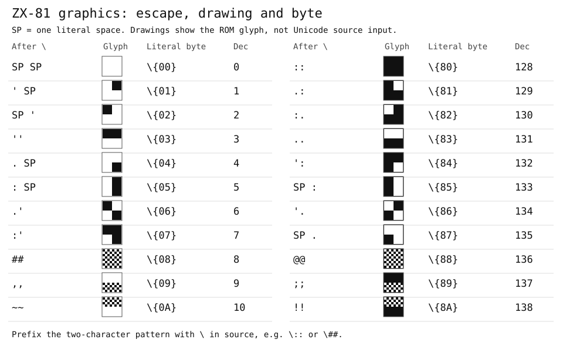

# MSX Basic DignifieR  
  
MSX Basic DignifieR **converts** **classic** MSX Basic **to** the **Dignified** format.  

This standalone conversion tool is **MSX-only**. ZX-81 has its own tool, the [ZX81 Basic DignifieR](#zx81-basic-dignifier), described at the end of this document.

It **eases** the heavily **repetitive** and **error** prone task of **removing** line numbers, **creating** branching labels, **adding** spaces between keywords, etc. Helps if you want to **convert** a **lot** of files or a **long** one for **editing** or just for **better visualization** / **reading**. There are a series of **options** to configure the **appearance** of the final Dignified code according to your **preferences**.  
  
> The interplay between all the configurable options and the variety of the Basic itself is somewhat complex and was not nearly as tested as it should so please keep an eye and report any bugs.  
  
## Usage  
  
  
Run with:  
`python msxbader.py <CLASSIC_CODE> [DIGNIFIED_CODE] [arguments]`  
  
### Arguments  
  
You can control the behavior of **MSX Basic DignifieR** through:  
  
`code:` The **code itself**.  
`cmdl:` Arguments on the **command line**.  
  
Command line arguments have **priority** over the code.  
  
- *Source file*  
The **classic** code file to be read.  
`Default:` `""`  
`code:` `self.file_load = <CLASSIC_CODE>`  
`cmdl:` `<CLASSIC_CODE>`  
  
- *Destination file*  
The **Dignified**  file to be saved.  
`Default:` **None**  
`code:` `self.file_load = <DIGNIFIED_CODE>`  
`cmdl:` `<DIGNIFIED_CODE>`  
If no name is given, the destination file will have the source name with the proper extension.  
  
- *Convert to lower case*  
**Convert** all text (**excluding** literals: **quotations**, **DATAs** and **REMs**) to **lowercase**.  
`Default:` `True`  
`code:` `self.conv_lower = [True|False]`  
`cmdl:` `-tl`  
  
- *Keep original spaces*  
All **spaces** are normalized to **1** by default. This will **keep** any **original** spaces beyond that.  
`Default:` `False`  
`code:` `self.keep_spcs = [True|False]`  
`cmdl:` `-ks`  
  
- *Convert `LOCATE:PRINT`*  
Convert `locate x,y:print` to `[?](x,y) `.  
`Default:` `True`  
`code:` `self.conv_locprt = [True|False]`  
`cmdl:` `-cp`  
  
- *Format labels*  
Define how **labels** are **converted**.  
(Add multiple letters to add functions)  
`i` **Indent** non label lines after the first label.  
`s` **Add** a blank line before each label.  
`Default:` `is`  
`code:` `self.format_label = ['i,s']`  
`cmdl:` `-fl <i,s>`  
  
- *Format REMs*  
Define how **REMs** are converted.  
(Add multiple letters to add functions)  
`l` Remove REMs **alone** on a line.  
`i` Remove REMs at the **end** of a line.  
`b` **Keep** blank REM lines as blank lines.  
`m` **Move** inline REMs above its original line.  
`k` **Add** a label if a REM directed by a **branching** instruction was **removed**.  
`Default:` `m`  
`code:` `self.format_rems = <l,i,b,m,k>`  
`cmdl:` `-fr <l,i,b,m,k>`  
  
- *Unravel `THEN/ELSE`*  
**Break** the line on `THEN` and/or `ELSE` with a `_` line break.  
(Add multiple letters to add functions)  
`t` Break the line **after** `THEN`.  
`n` Break the line **before** `THEN`.  
`e` Break the line **after** `ELSE`.  
`b` Break the line **before** `ELSE`.  
`Default:` `te`  
`code:` `self.unravel_if = <t,n,e,b>`  
`cmdl:` `-ut <t,n,e,b>`  
  
- *Unravel colons*  
**Break** the line on `:`.  
(Add multiple letters to add functions)  
`w` Break the line and **do not** indent.  
`i` Break the line **indenting** after the first `:`.  
`c` Put the `:` on the line **below**.  
`Default:` `ic`  
`code:` `self.unravel_colons = <i,w,c>`  
`cmdl:` `-uc <i,w,c>`  
  
- *Repel before keyword*  
A case insensitive **regex** string with **elements** which should **generate** a space **before** a keyword and them.  
`Default:` `[a-z0-9{}")$]`  
`code:` `self.repelcbef = [REGEX]`  
`cmdl:` `-rb <REGEX>`  
  
- *Repel after keyword*  
A case insensitive **regex** string with **elements** which should **generate** a space **after** a keyword and them.  
`Default:` `[a-z0-9{}"(]`  
`code:` `self.repelcaft = [REGEX]`  
`cmdl:` `-ra <REGEX>`  
  
- *Join before*  
A case insensitive **regex** string with **elements** forcing the **removal** of spaces **before** them.  
`Default:` `^(,|:)$`  
`code:` `self.stripsbef = [REGEX]`  
`cmdl:` `-jb <REGEX>`  
  
- *Join after*  
A case insensitive **regex** string with **elements** forcing the **removal** of spaces **after** them.  
`Default:` `^(,|:)$`  
`code:` `self.stripsaft = [REGEX]`  
`cmdl:` `-ja <REGEX>`  
  
- *Force spaces before*  
A case insensitive **regex** string with **elements** that must have a space **before** them.  
`Default:` `^(:|\+|-|\*|/|\^|\\)$`  
`code:` `self.spacesbef = [REGEX]`  
`cmdl:` `-sb <REGEX>`  
  
- *Force spaces after*  
A case insensitive **regex** string with **elements** that must have a space **after** them.  
`Default:` `^(#|\+|-|\*|/|\^|\\)$`  
`code:` `self.spacesaft = [REGEX]`  
`cmdl:` `-sa <REGEX>`  
  
- *Force together*  
A case insensitive **regex** string with **elements** that will be forced **together**.  
`Default:` `(<=|>=|=<|=>|\)-\()`  
`code:` `self.forcetogt = [REGEX]`  
`cmdl:` `-ft <REGEX>`  
  
- *Verbose*  
Set the level of feedback given by the program.  
 `0` = silent, `1` = +errors, `2` = +warnings, `3` = +steps, `4` = +details.  
`Default:` `3`  
`code:` `self.verbose_level = [#]`  
`.ini:` `verbose_level = [#]`  
`cmdl:` `-vb <#>`  
  
----
> **MSX Basic DignifieR** is part of the **Basic Dignified Suite**: https://github.com/farique1/basic-dignified  

## ZX-81 Module

The **ZX-81 module** converts **Dignified** source to numbered classic ZX-81 BASIC and tokenizes classic listings to `.p` files. It can also launch **EightyOne** with the generated program.

Classic listings can be converted to the Dignified format with the [ZX81 Basic DignifieR](#zx81-basic-dignifier), described below. There is no included `.p` detokenizer, so the listing must already be text. The MSX formatting arguments listed above do not apply to this module.

### ZX-81 File Formats

| Extension | Contents | Input mode |
| --- | --- | --- |
| `.DZX` | Dignified BASIC without line numbers, using labels for jumps | Normal conversion |
| `.AZX` | Classic BASIC with increasing line numbers | `-asc` |
| `.p` | Tokenized binary program | Output for the emulator, not text input |

The tokenizer is implemented in Python and needs no additional Python packages. An emulator is needed only to run the output, not to convert or tokenize it.

### ZX-81 Usage

Run the following commands from the **repository root**. Use `python3` instead of `python` if required by your installation.

**Convert Dignified source and tokenize:**

```console
python badig.py examples/zx81/zx81-intro.DZX -id zx81 --tk_tokenize
```

This writes numbered `.AZX` and tokenized `.p` files beside the source. Tokenization is enabled by default for ZX-81 unless changed in its configuration.

**Convert to ASCII only:**

```console
python badig.py examples/zx81/zx81-intro.DZX -id zx81 --tk_ascii_only
```

**Tokenize an existing numbered listing without Dignified conversion:**

```console
python badig.py game.AZX -id zx81 -asc --tk_tokenize
```

Classic mode preserves the listing's line numbers and does not create labels or rename variables. Without `-asc`, a numbered ZX-81 listing in a `.DZX` (or any non-`.AZX`) file is instead converted to labels in memory and passed through the Dignified pipeline, producing a renumbered `.AZX` with the usual options applied and long variable names mapped to single letters. Computed jump targets cannot be renumbered and stop the conversion. A numbered `.AZX` given without `-asc` is tokenized as is, so it is never overwritten.

**Convert, tokenize and run in EightyOne:**

```console
python badig.py examples/zx81/zx81-intro.DZX -id zx81 --tk_tokenize --em_run
```

For a classic listing, use `-asc --tk_tokenize --em_run` instead. Do not combine an ASCII-only conversion with emulator launch: EightyOne requires the `.p` output.

### ZX-81 Arguments

These are options for `badig.py`, not for `msxbader.py`.

| Option | Behavior |
| --- | --- |
| `-id zx81` | Select the ZX-81 dialect and tools; the suite otherwise defaults to MSX. |
| `-asc` | Treat the input as numbered classic ASCII BASIC and skip Dignified conversion. |
| `--tk_tokenize` | Enable `.p` generation explicitly. ZX-81 default: enabled. |
| `--tk_ascii_only` | Skip tokenization during Dignified conversion and generate `.AZX` only. |
| `--tk_del_ascii` | Delete the ASCII input to the tokenizer after tokenization. Default: disabled. |
| `--em_run` | Open the tokenized program in EightyOne. Default: disabled. |
| `-ls <number>` | Set the first generated BASIC line number during Dignified conversion. |
| `-lp <number>` | Set the generated line-number increment during Dignified conversion. |
| `-rh` | Suppress the generated informational `REM` header. |
| `-ca` | Capitalize generated code outside literal text. |
| `-ss` | Strip optional generated spaces; required separators are still retained. |
| `-vb <0-5>` | Set the suite's verbosity level. |

Use `python badig.py -id zx81 -h` for the complete list of common and module-specific arguments. The MSX/CoCo options `-cp` and `-tg` are not exposed by the ZX-81 language module.

> In classic mode the tokenizer's ASCII input is the original listing, so `--tk_del_ascii` is ignored and the source is never deleted.

### ZX-81 Configuration and Remtags

Tokenizer defaults are configured in `zx81/tokenizer_interface.ini`:

```ini
[CONFIGS]
tokenize = true
del_ascii = false
```

The same settings can be supplied by remtags in a Dignified source:

```basic
##BB:tk_tokenize=True
##BB:tk_del_ascii=False
##BB:em_run=False
```

For an ASCII-only build, use `##BB:arguments=--tk_ascii_only` without a conflicting `tk_tokenize=True` remtag. Tokenizer and emulator remtags are applied after their command-line settings and can override them.

Configure the emulator in `zx81/emulator_interface.ini`:

```ini
[CONFIGS]
run = false

[WINDOWS]
emulator_path = C:\zeddy\EightyOne.exe
```

Change `emulator_path` if EightyOne is installed elsewhere. The ZX-81 interface launches the program but does not monitor execution or provide MSX-style error reporting from the emulator.

### ZX-81 Dignified Syntax

Use labels instead of line numbers. Long variable names are allocated from `Z` down to `A`; a ZX-81 variable is one letter, optionally followed by `$`. Use `declare` to reserve a particular mapping.

```basic
declare message:m
message$ = "ZX-81"

{again}
[?](10,5) message$
if inkey$ = "" then goto {again}
stop
```

The built-in `[?](row,column)` define expands to `PRINT AT row,column;`. With no arguments it uses `0,0`; with one argument it uses that row and column `0`. Native `print at 10,5; message$` is also supported. Rows range from `0` to `21` and columns from `0` to `31`.

### ZX-81 Literal Bytes and Go81 Listings

For a side-by-side reference of source escapes, drawn block/checkerboard characters and byte codes, see [ZX-81 graphics in the language manual](BASIC_DIGNIFIED.md#zx-81-graphics-escape-and-drawing).



Both `.AZX` and `.DZX` support `\{XX}` for **one literal byte**, with exactly two hexadecimal digits in either case. For example, `\{d8}` and `\{D8}` both emit byte `D8`. This works in code, inside strings, and inside `REM`, including machine-code data exported by Go81's external `p2txt` converter.

```basic
600 REM \{D8}\{D8}\{D8}END OF GAME\{D8}\{D8}\{D8}
```

The escape is opaque: its byte does not open or close a string, start `REM` mode, or merge with a keyword or number. Tokenization continues normally after it. Malformed escapes such as `\{D}`, `\{GG}`, or `\{D8` report a line-numbered error. Existing graphics and inverse-video escapes retain their previous behavior; unlike `\{XX}`, they are not decoded inside `REM`.

Normally a numeric literal is followed by `7E` and five calculated floating-point bytes. If the digits are followed **immediately** by `\{7E}`, the calculated bytes are omitted. Supply the marker and all five hidden-value bytes explicitly:

```basic
30 LET A=0\{7E}\{81}\{00}\{00}\{00}\{00}
```

A space before `\{7E}` disables this special numeric handling. This allows listings whose displayed digits differ from their stored numeric value to retain the explicit hidden value.

Preserving line-body bytes does not guarantee an entire original `.p` will be reproduced identically: the tokenizer regenerates system variables, the display file and the variables area. Keep Go81's numbered listings as `.AZX` and use `-asc` to avoid Dignified transformations.

### ZX-81 Helpers and Editors

On PowerShell, pass a source path with its extension, or a base name to have `.DZX` appended automatically:

```powershell
.\zx81\convert-zx81.ps1 examples\zx81\zx81-intro
```

For a numbered listing such as `game.dzx`, run `.\zx81\convert-zx81.ps1 game`: it is renumbered into `game.AZX` and tokenized, without changing the source; direct `badig.py -id zx81` calls and the editor's Dignified tasks behave the same way.

The helper also accepts explicit `.AZX` paths for numbered listings, handles names with spaces or extra dots, and preserves the text source. **It deletes the destination `.p` before conversion**, so a failed build does not leave the previous binary available. Binary `.p` input is rejected. The broader CLI/Bash/editor error-propagation review remains open; see [the ZX-81 audit findings](IMPLEMENTATIONS.md#zx-81-audit-2026-11-03).

The Bash helper supports Dignified input: `bash zx81/convert-zx81.sh <program-base-name>`. On case-sensitive filesystems it requires the source suffix `.DZX` in uppercase. For classic input on either platform, use `badig.py` with `-asc`.

VS Code and Sublime Text packages provide syntax highlighting, snippets, conversion builds and EightyOne launch. In VS Code, choose a **Dignified** task for `.DZX` without line numbers and a **Classic** task for numbered `.AZX`.

Programs that keep machine code in a long `REM` line can create it with `remx <line>,<count>[,<byte>]`; it is not touched by the DignifieR or by renumbering. See [machine code REM lines](MODULE_TOOLS.md#machine-code-rem-lines-remx).

See the [installation guide](INSTALLATION.md), [editor integration guide](IDE_TOOLS.md), and [ZX-81 module guide](MODULE_TOOLS.md#zx-81-usage-and-byte-escapes) for setup and further examples. Unicode translation and a `.p` detokenizer are not currently implemented for ZX-81.

## ZX81 Basic DignifieR

ZX81 Basic DignifieR **converts** **classic** numbered ZX-81 BASIC **to** the **Dignified** format. It is meant for programs **typed** directly on a ZX-81, copied from a **book** or **magazine**, or exported by Go81 `p2txt`, that you now want to **edit**, **renumber** and give **meaningful variable names**.

It **removes** line numbers, **creates** labels for numeric `GOTO`, `GOSUB`, `RUN`, `LIST` and `LLIST` targets, normalizes `GO TO`/`GO SUB`, **converts** `PRINT AT` to `[?]`, adds the spaces the Dignified syntax requires and can **rename** variables. Strings, `REM` text, graphics and `\{XX}` byte escapes are kept as they are.

The ZX-81 has no `:` statement separator or `ELSE`, so the MSX colon and `ELSE` options do not exist here.

### Workflow

1. Convert the classic listing to Dignified:  
`python zx81/zx81bader.py book.AZX -rv s:score,x:ship`
2. Edit `book.DZX` as Dignified code: indent it, add comments, give long names to more variables, or use `declare` to choose their letters.
3. Convert it back with the line numbering you want:  
`python badig.py book.DZX -id zx81 -ls 100 -lp 5`

Badig numbers the lines again and maps each long variable name to a single ZX-81 letter, from `Z` down, keeping `$` for strings.

> A numbered `.DZX` given straight to `badig.py -id zx81` is also renumbered, but it skips step 2: its variables keep their names and its layout stays the same. Use the DignifieR when you want to work on the program as Dignified code.

### Usage

Run with:  
`python zx81/zx81bader.py <CLASSIC_CODE> [DIGNIFIED_CODE] [arguments]`

### Arguments

You can control the behavior of **ZX81 Basic DignifieR** through:

`code:` The **code itself**, by changing the user variables at the top of `zx81/zx81bader.py`.  
`cmdl:` Arguments on the **command line**.

Command line arguments have **priority** over the code.

- *Source file*  
The **classic** code file to be read. Any extension can be used, usually `.AZX` or a numbered `.DZX`.  
`Default:` `""`  
`code:` `file_load = <CLASSIC_CODE>`  
`cmdl:` `<CLASSIC_CODE>`

- *Destination file*  
The **Dignified** file to be saved.  
`Default:` **None**  
`code:` `file_save = <DIGNIFIED_CODE>`  
`cmdl:` `<DIGNIFIED_CODE>`  
If no name is given, the destination is the source name with the `.DZX` extension. If that would be the source itself, `_dig` is added to the name (`game.dzx` becomes `game_dig.DZX`), so the classic listing is never overwritten.

- *Convert to lower case*  
**Convert** keywords and variables to **lowercase**. Strings, `REM` text and escapes are not changed.  
`Default:` `True`  
`code:` `conv_lower = [True|False]`  
`cmdl:` `-tl` (keep the original case)

- *Keep original spaces*  
Spaces are normalized by default. This will **keep** the **original** spacing between elements.  
`Default:` `False`  
`code:` `keep_spcs = [True|False]`  
`cmdl:` `-ks`

- *Convert `PRINT AT`*  
Convert `PRINT AT r,c;` to `[?](r,c)`. Only the first `AT` after `PRINT` is converted; positions later in the same statement are kept.  
`Default:` `True`  
`code:` `conv_printat = [True|False]`  
`cmdl:` `-cp` (do not convert)

- *Format labels*  
Define how **labels** are **converted**.  
(Add multiple letters to add functions)  
`i` **Indent** non label lines after the first label.  
`s` **Add** a blank line before each label.  
`Default:` `is`  
`code:` `format_label = '<i,s>'`  
`cmdl:` `-fl <i,s>` (use `-fl ""` for neither)

- *Format REMs*  
Define how **REMs** are converted.  
(Add multiple letters to add functions)  
`l` Remove `REM` lines. A label is still created if a jump points to the removed line.  
`b` **Keep** empty `REM` lines as blank lines.  
`Default:` `""`  
`code:` `format_rems = '<l,b>'`  
`cmdl:` `-fr <l,b>`

- *Unravel `THEN`*  
**Break** the line on `THEN` with a `_` line break.  
(Add multiple letters to add functions)  
`t` Break the line **after** `THEN`.  
`n` Break the line **before** `THEN`.  
`Default:` `""`  
`code:` `unravel_if = '<t,n>'`  
`cmdl:` `-ut <t,n>`

- *Rename variables*  
Give **meaningful names** to variables. Use `old:new` pairs separated by commas; string variables keep the `$` on both names (`a$:name$`). New names must be valid Dignified identifiers and cannot be keywords or names already used in the program.  
`Default:` `""`  
`code:` `rename_vars = 'old:new,old$:new$'`  
`cmdl:` `-rv old:new,old$:new$`

- *Verbose*  
Set the level of feedback given by the program.  
 `0` = silent, `1` = +errors, `2` = +warnings, `3` = +steps, `4` = +details.  
`Default:` `3`  
`code:` `verbose_level = [#]`  
`cmdl:` `-vb <#>`

### Example

```BASIC
10 LET S=0
20 LET S=S+1
30 IF S<5 THEN GOTO 20
40 PRINT AT 2,4;S
```

`python zx81/zx81bader.py count.AZX -rv s:score`

```BASIC
let score=0

{l_20}
	let score=score+1
	if score<5 then goto {l_20}
	[?](2,4) score
```

`python badig.py count.DZX -id zx81 -rh -ls 100 -lp 5`

```BASIC
100 let z=0
105 let z=z+1
110 if z<5 then goto 105
115 print at 2,4;z
```

### Messages and limits

- Lines must start with a number in increasing order; otherwise the conversion stops.
- A jump to a missing line uses the **next existing line**, as on the ZX-81.
- **Computed** jumps such as `GOTO 10*X` are kept as they are and give a warning: they will point to the wrong lines after renumbering, so review them by hand.
- Variables named like Dignified keywords (`EXIT`, `TRUE`, `KEEP` and similar) give a warning; rename them with `-rv`.
- Lines starting with `#`, ignored by the ZX-81 tokenizer, become `##` Dignified comments.
- Badig may warn about a *Reserved short variable conflict* when a long name starts with the same letter as a one-letter variable, such as `ground$` and `g`. On the ZX-81 the long name still receives its own letter, so the warning is harmless.

----
> **ZX81 Basic DignifieR** is part of the **Basic Dignified Suite**: https://github.com/farique1/basic-dignified
