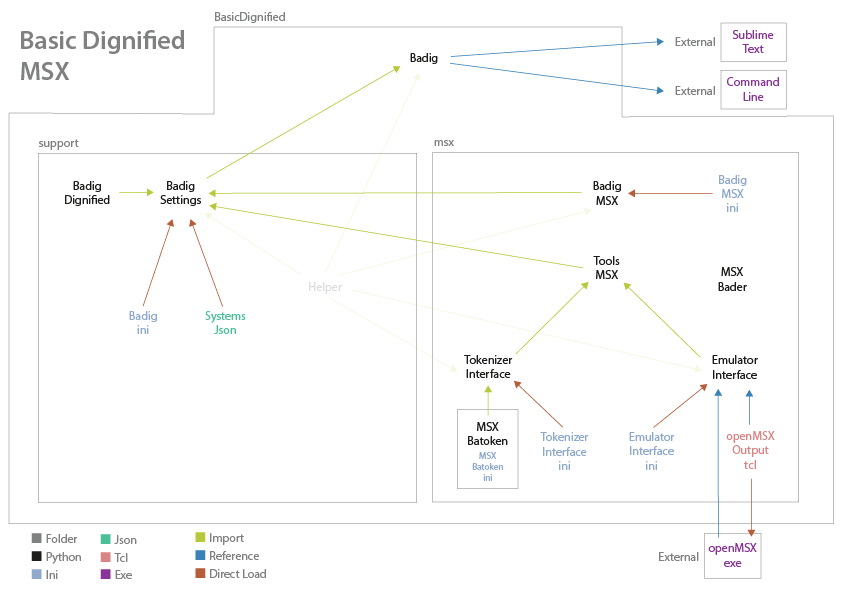

# New Modules  

> A complete guide on how to implement new systems is coming soon.  
> This is only a small overview.  
  
Modules for **new systems** should be placed on **folders** named with their **system ID**.  
The **language** module for the **classic** system must be named `badig_SYSTEM-ID.py`.  
The **tools** module for the **classic** system must be named `tools_SYSTEM-ID.py`.  

The **language** module **describes** and adds **control** to the **conversion** fom the **Dignified** to the **classic** versions.  
The **tools** module **control** all **interfaces** associated with **programs** helping the **conversion** like **tokenizers** and **emulators**.  
The **interfaces** directly **control** the **external programs** like **tokenizers** and **emulators**, making a **bridge** between them and Basic Dignified and adding **configurations** and **features**.  

The included system IDs are **msx**, **coco** and **zxspectrum**.
The Spectrum example below shows how a dialect can reuse the shared
pipeline while supplying a different tokenizer, characters and output formats.

The **MSX folder** opened with its **files** as an example of a **typical** module.

```  
|- documentation  
|- examples  
|- images  
|- coco  
|- msx  
   |- msxbatoken
   |  badig_msx.ini
   |  badig_msx.py
   |  emulator_interface.ini
   |  emulator_interface.py
   |  msxbader.py
   |  openmsx_output.tcl
   |  tokenizer_interface.ini
   |  tokenizer_interface.py
   |  tools_msx.py
|- support  
|  badig.py  
```  
  
A **schematic** of the **relationship** between the **files** of Basic Dignified and the **MSX** module.  
   
  
The structure of the lexer and parser on the main Basic Dignified and MSX module:  

### Lexer  
- **Lex**  
  - Get tokens  
  - Token errors  
  - Adjust token values
  - Get REM blocks and lines  
  - Get quotes  
  - `Classic module`  
    - Process DATA lines

### Parser
- Initialize
  - `Classic module`
    - Add [?] to the DEFINE dictionary
- **Pass 1**  
  - Remove REM TOGGLES
  - Dignified instructions
    - EXIT
    - INCLUDE
    - ENDIF
    - DEFINE
    - DECLARE
    - KEEP
    - FUNC
    - RET
  - Replace DEFINES
  - `Classic module`
    - Convert _ to CALL
    - Convert identifier to _ identifier
- **Pass 2**  
  - Replace function calls
  - Get Labels
    - Jump labels
    - Label lines
    - Loop return
    - Loop EXIT
  - `Classic module`
> - Post pass  
    - Check FUNC and label closing errors
- **Pass 3**  
  - Add INCLUDE
  - `Classic module`
    - Get hard variables
  - Adjust lines
    - Add REM blocks
    - Remove excess NEWLINES
    - Remove excess :
    - Remove NEWLINE after _
    - Remove NEWLINE after :
    - Remove NEWLINE before :
    - Remove NEWLINE after label lines
    - Remove NEWLINE after function definitions
    - Join strings on the same line
    - Join strings on the previous line
- **Pass 4**  
- - Apply header
  - Get labels line numbers and more info
    - Label lines
    - Jump labels
    - EXIT command
  - Get functions line numbers and more info
    - Function definitions
    - Function calls
  - Add line number
  - `Classic module`  
    - Process variables
> - Post pass  
    - Replace jump placeholders for line numbers  
    - Replace EXIT command placeholders for line numbers  
    - Replace function call placeholders for line   numbers  
- **Pass 5**  
  - `Classic module`
    - Convert ? to/from PRINT
    - Strip THEN
    - Strip GOTO
    - Replace unary and assignment operator
    - Replace TRUE and FALSE
    - Translate Unicode to ASCII 
  - Capitalize
- **Generate**  
  - Check translated characters
  - Process a line
    - `Classic module`
      - Separate X from OR
      - Separate hex numbers from A-F words
    - Add space before token
    - Add space after token
  - Add label report to the end of the line
  - Add a linefeed to the end of the line
  - Check line size

<!-- 
Note:
Standardize `em_run` and `tk_tokenize` arguments when available so the build systems are compatible. -->

## ZX Spectrum

The `zxspectrum` package provides a small working example of the dynamic module contract:
`badig_zxspectrum.py`, `tools_zxspectrum.py`, `tokenizer_interface.py`,
`tokenizer_zxspectrum.py`, `tape_zxspectrum.py` and `emulator_interface.py`.
The optional `snapshot_zxspectrum.py` worker invokes locally installed
SkoolKit in a temporary directory, validates the ROM-loaded state and
serializes the matching 48K SNA. DZS/AZS are module defaults, not changes
to the shared MSX/CoCo source/listing defaults.

Two optional core hooks are used without changing MSX/CoCo defaults:

- `Classic.Lexer.quoted_string(tok, end, part, position)` reads a quoted
  literal when implemented by a dialect, allowing Sinclair doubled quotes.
- `Classic.postprocess(code, settings)` checks the final numbered listing
  before it is saved; Spectrum also inserts its absolute REMX reservations
  here, after normal numbering/labels and ordinary line-size checks.

REMX is recognized by the dialect lexer as a literal directive and collected
in parser pass 1, so INCLUDE and rem toggles retain their normal behavior.
Pass 4 includes its source positions in line reports. Character escapes are
decoded by the Spectrum tokenizer inside strings/REM, not by the shared lexer.

Since Spectrum 1.5.1, a language module may also declare `ERROR_EXIT_CODE = 1`
to opt into nonzero fatal exits from the shared `Infolog`. Modules without
this attribute retain the legacy code 0. Settings initialization resets this
process-wide policy before selecting a dialect, then applies the selected
module's value to all logger instances, including those created earlier.
Caught main-INI diagnostics are reported after selection so `-id` overrides
and INI-selected systems use the appropriate status. Level-1 messages with
a custom bullet remain nonfatal; help and successful INI writing still exit 0.

Spectrum inherits existing class scaffolding but supplies its own lexical
groups, category-aware name validation, number encoding and TAP/TZX structure.
The emulator adapter copies profiles into a temporary directory, passes
arguments without a shell, waits for exit and reports failures explicitly.
See the [Spectrum manual](ZX_SPECTRUM.md) and [implementation plan](../OUTLINE.md).